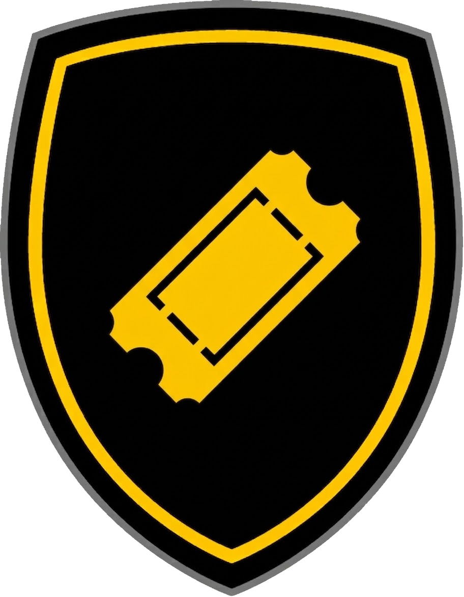

<div align="center">



<br/>
<br/>
<br/>

# OvalBot

[](https://github.com/ficaud/Ovalbot/actions/workflows/ci.yml)
[](https://github.com/ficaud/Ovalbot/actions/workflows/deploy.yml)
[](https://codecov.io/gh/ficaud/Ovalbot)

</br>
</div>

OvalBot emails you when a TOP14 match gets a confirmed date, and shows the Stade Rochelais (and many others) calendar. Registration is open, gated by a 10-person waitlist during this early phase.

- Stack: **Rust / Axum** (backend) + **SvelteKit** (frontend) + **SQLite**.
- Hosted on a Raspberry Pi (arm64) via Docker Compose.

## Structure

- `src/` — Rust backend (Axum server + `create_admin` CLI)
- `calendar/` - Rust backend responsible for parsing the Top14 calendar.
- `migrations/` — SQL migrations (sqlx, embedded at runtime).
- `frontend/` — SvelteKit app (Svelte 5, `adapter-static`).
- `doc/specs/` — specifications (`cdc.md` + per-phase specs).
- `templates/` - HTML emails templates.
- `tests/` - Rust tests.

## Development

### Backend

```bash
cargo run --bin ovalbot          # start the API + static frontend (port 3000)
cargo run --bin create_admin -- --email <email> --password <pwd>
cargo test --workspace          # unit + integration tests (both crates)
cargo fmt --check && cargo clippy --all-targets --all-features -- -D warnings
```

The backend serves the built frontend from `frontend/build` (override with the
`STATIC_DIR` environment variable). Email HTML is loaded from `templates/`
(override with `TEMPLATE_DIR`); see `welcome.html` and `match_alert.html`.

### Frontend

```bash
cd frontend
npm ci                          # install exact dependencies from package-lock.json
npm run dev                      # dev server on port 5173 (proxies /api -> :3000)
npm run build                    # static build into frontend/build
npm run check                    # svelte-check (types)
```

### Devcontainer

The project ships a plain devcontainer (`.devcontainer/`) with Rust, Node.js and
SQLite. It does **not** include personal tooling (such as neovim, zsh, gitconfig) — those
live in a separate `ovalbot-devenv` overlay image.

#### Base devcontainer (no overlay)

Open the folder in VS Code with the "Dev Containers" extension and choose
**"Reopen in Container"** (or open a Codespace). This uses
`.devcontainer/devcontainer.json` directly and drops you into a `bash` shell as
the `devuser` user, with ports `3000` (backend) and `5173` (frontend) forwarded.

From the command line (without VS Code):

```bash
devcontainer up --workspace-folder .            # build (first time) + start
devcontainer exec --workspace-folder . bash     # open a shell
```

#### With the personal overlay (recommended)

Works better with a personal overlay that contains your personal settings (e.g. neovim).

Open a shell with `devcontainer exec --workspace-folder . zsh` or
`./my-env/up.sh`, then:

```bash
./my-env/up.sh                   # build images + start container + link configs
./my-env/up.sh --no-cache        # rebuild images
./my-env/down.sh                 # stop the container
```

To start the container without rebuilding the images (uses the existing
`ovalbot-personal` image):

```bash
export OVALBOT_HOST_UID="$(id -u)" OVALBOT_HOST_GID="$(id -g)"
devcontainer up --workspace-folder . --override-config my-env/devcontainer.override.json
devcontainer exec --workspace-folder . /workspaces/OvalBot/my-env/link.sh
devcontainer exec --workspace-folder . zsh
```

## Configuration

The backend reads these environment variables:

| Variable | Default | Description |
|---|---|---|
| `DATABASE_URL` | `sqlite://ovalbot.db` | SQLite connection string. |
| `STATIC_DIR` | `frontend/build` | Directory holding the built SvelteKit frontend. |
| `TEMPLATE_DIR` | `templates` | Directory holding the HTML email templates. |
| `RESEND_ENABLED` | `false` | Set `true` to send emails via Resend (welcome + match alerts). |
| `RESEND_API_KEY` | *(empty)* | Resend API key, required when `RESEND_ENABLED=true`. |
| `RESEND_FROM` | `OvalBot <onboarding@resend.dev>` | Sender address for outgoing emails. |

See `.env.example` for a ready-to-copy template.

## Testing

### Option A — simulated production (backend serves the built frontend)

```bash
DATABASE_URL="sqlite:///tmp/test.db" cargo run --bin ovalbot
```

### Option B — local dev with hot reload (two terminals)

Terminal 1 — backend on `:3000`:

```bash
cargo run --bin ovalbot
```

Terminal 2 — frontend on `:5173` (proxies `/api` -> `:3000`):

```bash
cd frontend && npm run dev
```

Open http://localhost:5173 (ports 5173 and 3000 are forwarded in the devcontainer).

### Create an admin account (to test the admin panel)

```bash
DATABASE_URL="sqlite:///tmp/test.db" cargo run --bin create_admin -- --email admin@example.com --password password123
```

## Calendar crate testing

The LNR parser tests (`calendar/src/parse/lnr.rs`) read committed HTML fixtures
from `calendar/src/parse/fixtures/`. To regenerate those fixtures from the live
site, run:

```bash
cargo test capture_lnr_fixture -- --ignored
```

## Deployment (Raspberry Pi, arm64)

`deploy.yml` builds a `linux/arm64` image and publishes it to GHCR on every `v*`
tag (`ghcr.io/ficaud/ovalbot:<version>`, plus `<major>.<minor>` and `latest`).
The image contains the compiled backend, the built frontend, and the
`create_admin` CLI. The Pi only needs to pull and run it.

### 1. Prerequisites

- 64-bit OS (Raspberry Pi OS 64-bit / any arm64 distro).
- Docker Engine + the Compose plugin.

```bash
curl -fsSL https://get.docker.com | sh
sudo usermod -aG docker $USER          # log out/in afterwards
docker --version && docker compose version
```

### 2. Configure

Get the docker-compose.yml file from the OvalBot GitHub project as an example.

Copy the example env file and adjust the values:

```bash
cp .env.example .env
```

- `OVALBOT_VERSION`: tag to deploy (pin it, e.g. `v1.0.0`, for reproducibility).
- `PORT`: host port exposed by the container (default `3000`).

The SQLite database is stored in `./data` next to `docker-compose.yml`. Create it
writable by the container user (uid `10001`) before the first run:

```bash
mkdir -p data && chown -R 10001:10001 data
```

### 3. Run

```bash
docker compose up -d                 # pulls the image and starts detached
docker compose logs -f ovalbot       # follow the logs
```

The service restarts automatically (`restart: unless-stopped`) and persists its
SQLite database in the `./data` directory next to `docker-compose.yml`.

### 4. Create the first admin account

```bash
docker compose exec ovalbot create_admin --email admin@example.com --password '<pwd>'
```

This runs the `create_admin` CLI inside the container, against the same
`DATABASE_URL` and `./data` directory as the server.

### 5. Update to a new version

```bash
docker compose pull && docker compose up -d
```

